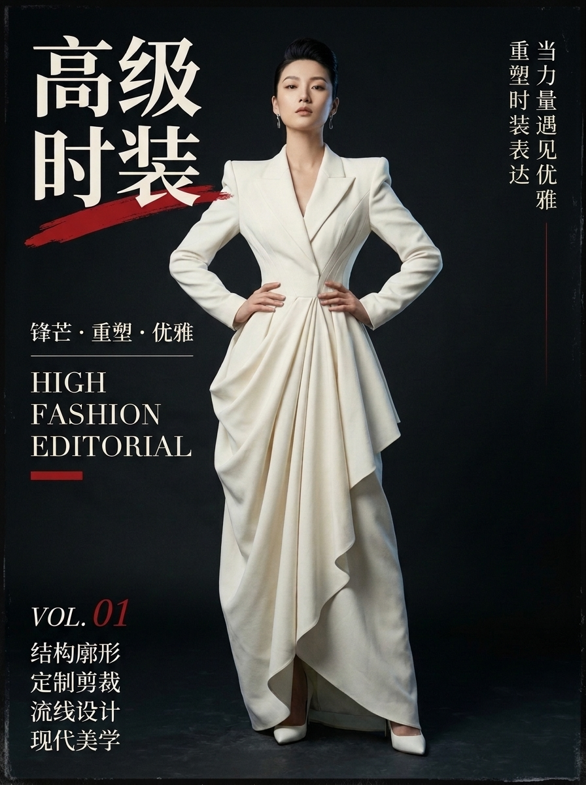
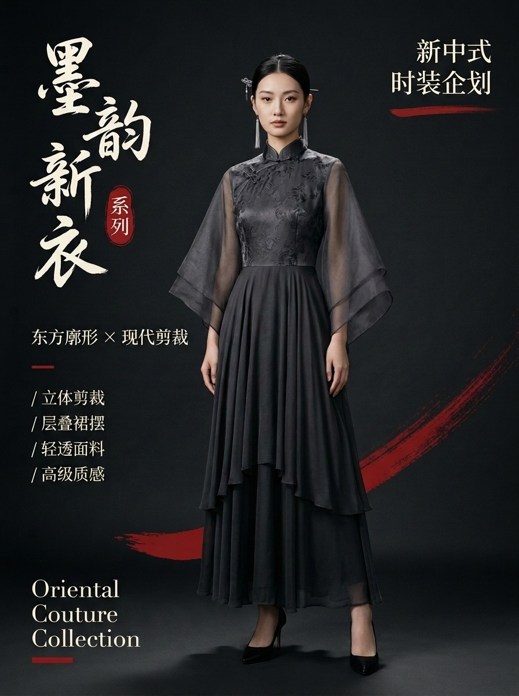
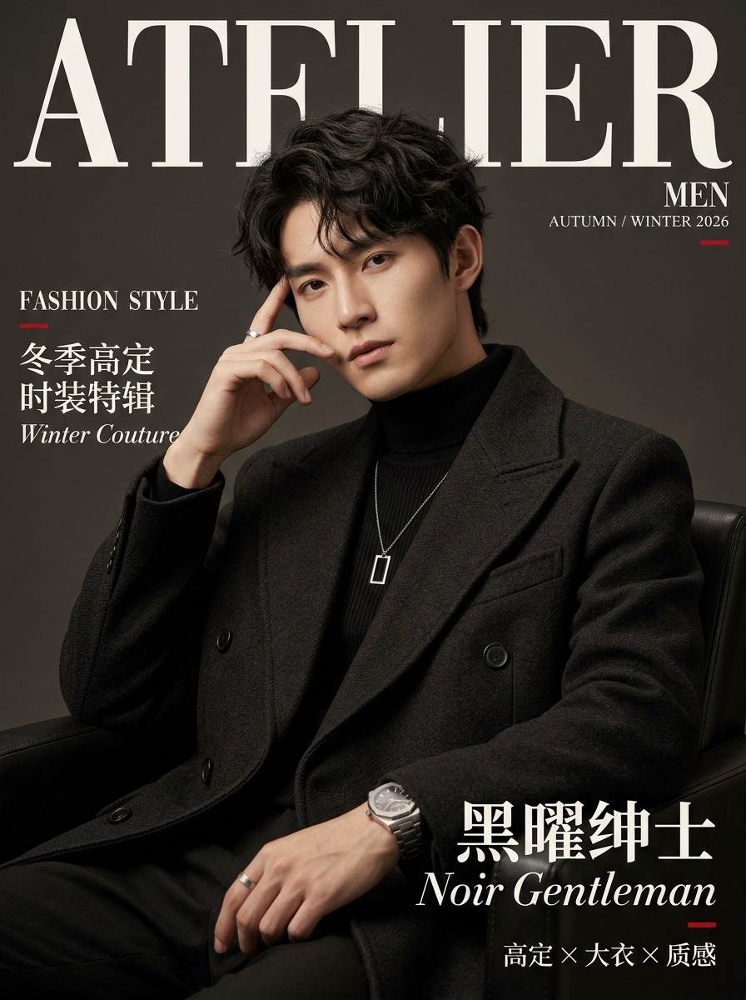
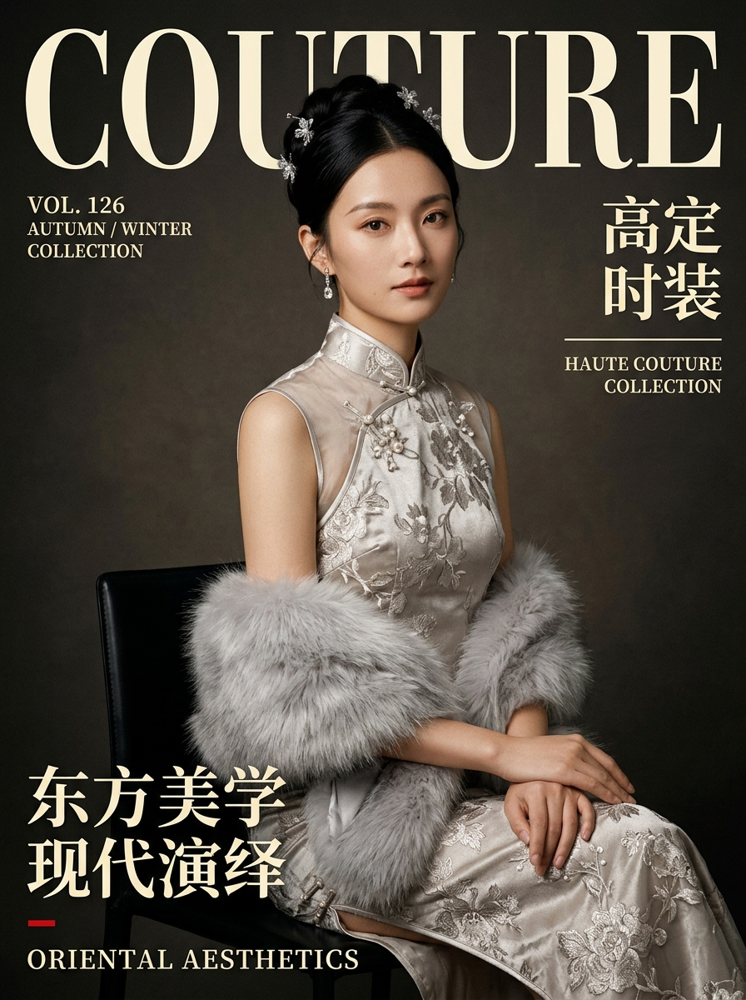
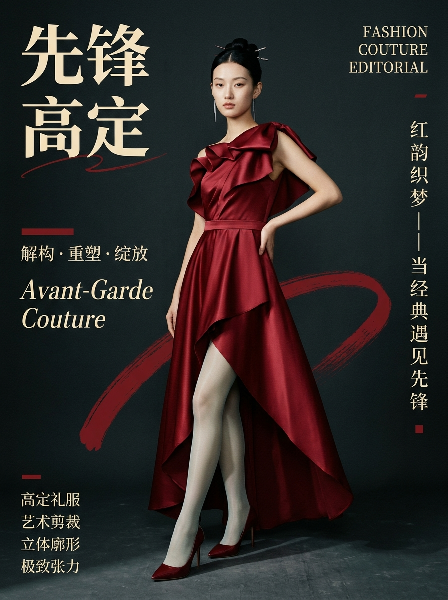
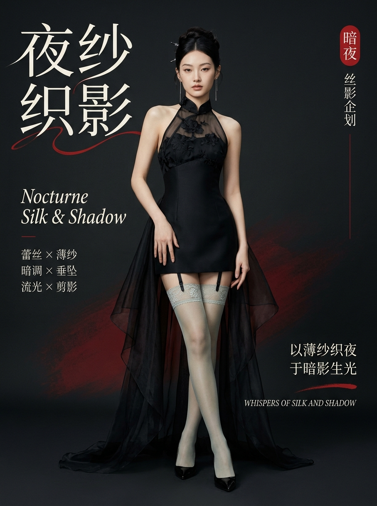

# Noir Couture Editorial Skill

> **暗调高定杂志风 Agent Skill** —— 从高定棚拍视觉规范提炼出的可复用 AI 绘图技能包，稳定输出统一质感的中英双语时尚大片、新中式高定海报与奢侈品杂志封面。

[](./skills/noir-couture-editorial/SKILL.md)
[](./skills/noir-couture-editorial/references/style-dna.md)
[](./LICENSE)

---

## 实测效果展示 / Showcase

同一套 Skill 的六张样图。01、02、05、06 展示全身海报，03、04 展示杂志封面。每张图的原始提示词见[样例集](./skills/noir-couture-editorial/examples/showcase-prompts.md)。

| 01 · 建筑感高定海报 | 02 · 新中式墨韵海报 |
| :---: | :---: |
|  |  |
| **03 · 男装高定封面** | **04 · 女装东方高定封面** |
|  |  |
| **05 · 深红缎面海报** | **06 · 黑曜薄纱海报** |
|  |  |

---

## 核心风格基因 / Style DNA

这套风格从构图、色彩、字体和摄影四方面维持系列感。以下为默认设置，用户可指定画幅、服装颜色和上版文案。

1. **双模态版式系统 (`Dual-Mode Grid`)**
   - **Mode A (`poster` — 全身暗调高定海报)**：3:4 竖版全身 T 台站姿，磨砂黑曜石水泥质感背景（`#121315`–`#25272A`），左上主标呼应服装廓形，可搭配右侧竖排副标或下方工艺标签，左右留白充足。
   - **Mode B (`cover` — 奢华杂志封面)**：3:4 坐姿半身/七分身特写，暖深灰褐无缝棚拍背景（`#3E3A37`–`#58524D`），顶部通栏超窄高对比衬线刊头（`ATELIER` / `COUTURE` / `ELITE` 等原创刊名）**严格置于模特发丝之后**形成真实印刷层次感。
2. **极度克制的色彩预算 (`Color Discipline`)**
   - 背景与文字以黑曜石、暖灰褐和暖象牙白为主，服装保留指定颜色，例如样图 05 的深红缎面。
   - **朱砂红（`#B81D24`）用于平面点缀**，通常控制在全画面约 **5% 以内**，可用笔刷底线、2px 短横杠、小印章或暗处背景飞白形式出现。
3. **服装驱动的定制字体系统 (`Garment-Driven Bespoke Typography`)**
   - **拒绝死板默认宋体与千篇一律的「高定时装」套话**：每张图都会根据服装面料、剪裁和廓形选择最契合的字体气质——可自由适配开源免费字体风格（*霞鹜文楷*、*马善政毛笔楷书*、*江西拙楷*、*思源黑/宋体*、*Cormorant Garamond*、*Bodoni Moda*、*Cinzel*、*Syne*），也可直接让 AI 创作**定制艺术字体**（如适配黑纱蕾丝的瘦金丝带体、适配金属褶皱的液态铬金刀锋体、适配解构风衣的断笔无衬线体）。
   - **文字数量防崩机制**：自行拟稿时，主标建议用 2–4 字，全图汉字尽量控制在约 30 字（如 `夜纱织影`、`松烟入画`、`液态极光`）。用户给定的标题逐字保留，出图后核对字形和拼写，优先精简可选副文案。
4. **中画幅棚拍光学锚点 & 防跑偏护栏 (`Anti-Drift Guardrails`)**
   - 85mm–100mm 中画幅棚拍质感、35° 高位轮廓柔光、发丝边缘轮廓光、真实织物经纬肌理与细腻胶片颗粒。
   - 明确禁用霓虹赛博色调、塑料感 CG 皮肤、非原创商标 Logo（如 `VOGUE`）以及杂乱场景道具。

---

## 快速安装 / Quick Install

### 方式一：通过 Skills CLI 安装（推荐）

```bash
npx skills add hndira/noir-couture-editorial
```

### 方式二：手动安装到 Antigravity / Claude Code / Codex

将仓库内的 `skills/noir-couture-editorial` 目录复制到你的全局或项目 Skills 目录：

- **Antigravity（全局）**：`~/.gemini/config/skills/noir-couture-editorial/`
- **项目级通用（Antigravity / Codex / OpenClaw）**：`<project>/.agents/skills/noir-couture-editorial/`
- **Claude Code**：`~/.claude/skills/noir-couture-editorial/`

```bash
git clone https://github.com/hndira/noir-couture-editorial.git
mkdir -p ~/.gemini/config/skills
cp -r noir-couture-editorial/skills/noir-couture-editorial ~/.gemini/config/skills/
```

---

## 使用示例 / Sample Prompts

在支持图像生成的 Agent 中可以直接请求出图。只需要提示词时，可在请求里写「只给提示词」；没有生图工具的环境也能输出完整提示词。

- **生成新中式海报**：
  > 用 `noir-couture-editorial` 风格，生成一张新中式墨绿暗纹丝绸立领长裙海报，主标题「松烟入画」，配英文副标题 `Oriental Ink Couture`。
- **生成男装杂志封面**：
  > 用 `noir-couture-editorial` 的 Cover 模式，做一张 `MAISON` 冬季男装封面，模特穿炭灰羊绒风衣配高领毛衣，主题叫「凛冬风骨 / Winter Silhouette」。
- **生成极简银色未来感高定**：
  > 按 `noir-couture-editorial` 规范，生成一张液态金属褶皱不对称礼服全身海报，主标「银翼秩序」，保留朱红笔刷划痕和 `VOL. 08` 编号。

---

## 仓库结构 / Repository Structure

```text
noir-couture-editorial/
├── README.md
├── LICENSE
├── assets/
│   └── showcase/
│       ├── 01-architectural-ivory-poster.jpg
│       ├── 02-neo-chinese-ink-poster.jpg
│       ├── 03-menswear-atelier-cover.jpg
│       ├── 04-womenswear-couture-cover.jpg
│       ├── 05-crimson-avant-garde-poster.jpg
│       └── 06-obsidian-suspender-bespoke-type.jpg
└── skills/
    └── noir-couture-editorial/
        ├── SKILL.md                         # 核心工作流与触发说明
        ├── references/
        │   ├── style-dna.md                 # 色板、双模态网格、打光与防跑偏规范
        │   └── prompt-templates.md          # 4 套即插即用提示词蓝图
        └── examples/
            └── showcase-prompts.md          # 本仓库 6 张样图的原始提示词
```

---

## License

Released under the [MIT License](./LICENSE).
